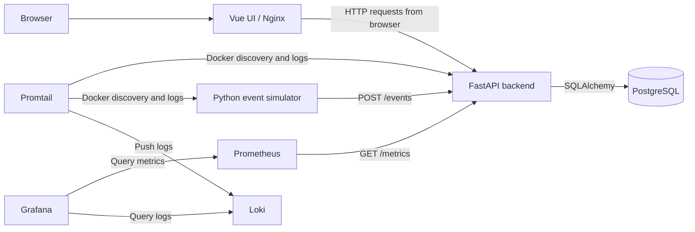

# SimOps — Operations and incident runbook

This runbook describes the **Docker Compose implementation in this repository**, not a verified production deployment. Refer to [architecture](architecture.md), [API contract](api-contract.md), and the root [README](../README.md).

## Architecture at a glance



The arrows for metrics and log ingestion indicate **who initiates the connection**: Prometheus scrapes the backend, while Promtail discovers and reads selected Docker containers. Grafana queries both data sources. Promtail's Docker socket is mounted read-only but still represents a security-sensitive integration.

## First-response checks

Run from the repository root with the expected `.env` loaded:

```bash
docker compose config
docker compose ps
docker compose logs --tail=100 backend db simulator
curl -fsS http://localhost:8000/health
curl -fsS http://localhost:8000/ready
curl -fsS http://localhost:8000/metrics | head
```

These are **diagnostic commands**, not evidence that they were executed successfully in a particular environment. `/health` indicates API process liveness; `/ready` also performs a minimal database connectivity check. If the API uses loopback-only port bindings, run the curl commands on the host.

## API errors and unavailable backend

1. Inspect `docker compose ps` and `docker compose logs --tail=100 backend`.
2. Check `/health`, then `/ready`; a healthy process does not guarantee database readiness.
3. If the backend restarts, inspect startup logs for Alembic failures. The current Compose backend command runs `alembic upgrade head` before Uvicorn.
4. Check database health: `docker compose ps db` and `docker compose logs --tail=100 db`.
5. Validate `SIMOPS_DATABASE_URL` composition and database credentials **without printing secrets**.
6. If the UI loads but API requests fail, inspect browser network requests, `SIMOPS_API_BASE_URL`, CORS origins and allowed hosts. The frontend uses runtime `config.js`.

## No events or unexpected latency

1. Confirm the simulator is running: `docker compose ps simulator`.
2. Inspect its logs: `docker compose logs --tail=100 simulator`.
3. Query `GET /events` and inspect `GET /metrics`.
4. Compare event timestamps with ingestion timestamps. Simulated failures, bursts and delays are expected behaviors, configured via `SIMULATOR_*` variables.
5. Check Grafana panels against the raw API and Prometheus queries before assuming data loss.

## Missing metrics or logs

- **Metrics:** `docker compose logs --tail=100 prometheus`. Verify the scrape target `backend:8000` in `infra/prometheus/prometheus.yml` and that the backend exposes `/metrics`.
- **Logs:** `docker compose logs --tail=100 promtail loki`. Promtail targets **backend and simulator only** via Docker discovery; absence of database/frontend logs in Loki is expected.
- **Dashboards:** Check Grafana provisioning in `infra/grafana/provisioning/`; datasource URLs use internal Compose service names.

## Data safety and recovery limitations

The repository defines persistent Docker volumes for PostgreSQL, Prometheus, Loki and Grafana. **`docker compose down -v` deletes named volumes** and must not be part of routine troubleshooting.

The checked-in Compose configuration does **not** establish an automated PostgreSQL-to-S3 backup, tested restore process, AWS deployment pipeline, or public TLS termination. Do not infer these from `.env.prod.example`: that file is a configuration starting point. If backups exist outside this repository, document their commands, schedule, restore verification and evidence separately before claiming reproducible recovery.

## Operational security

Defaults in Compose are development-oriented. For any shared deployment: change PostgreSQL/Grafana credentials, restrict published ports, set allowed hosts and CORS explicitly, and review Docker socket access for Promtail. The file `.env.prod.example` illustrates loopback bindings but does not itself configure an edge reverse proxy or TLS.

## After an incident

Capture sanitized timestamps, affected endpoint, symptoms, relevant logs/metrics, root cause (if established), mitigation and follow-up tasks. Avoid embedding tokens, connection strings with passwords or real production data in issue reports.
